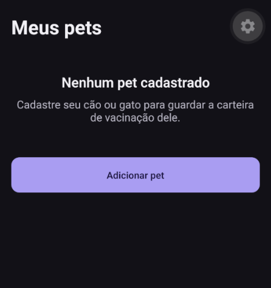

# Vacinas do Pet

🇧🇷 Português · [🇺🇸 English](README.en.md)

App móvel de código aberto para guardar a carteira de vacinação de cães e gatos, com a foto do comprovante de cada dose e lembretes da próxima.

- **100% local:** sem conta, sem login, sem servidor. Os dados ficam só no seu aparelho e o app funciona em modo avião.
- **Sem anúncios, rastreamento ou analytics.**
- Feito com [Expo](https://expo.dev) e React Native. O primeiro release será para Android; o iOS está planejado para depois.

> **Status:** o MVP está com todas as funções implementadas e ainda **não foi lançado**. O primeiro release (Android) depende de pendências abertas: [revisão veterinária do catálogo (#5)](https://github.com/celsottg/petVaccines/issues/5), [validação dos lembretes em aparelho físico (#12)](https://github.com/celsottg/petVaccines/issues/12), [validação do PDF em aparelho físico (#14)](https://github.com/celsottg/petVaccines/issues/14), o ícone do app e a ficha da loja. Veja o [checklist de release](docs/release-checklist.md), o [design do MVP](docs/superpowers/specs/2026-11-12-pet-vaccines-design.md) e o [plano de implementação](docs/superpowers/plans/2026-11-12-pet-vaccines-mvp.md).

Privacidade: veja a [política de privacidade](docs/privacy-policy.md) ([English](docs/privacy-policy.en.md)).

## O que o app faz

- **Pets:** cadastro de cães e gatos, com foto, edição, baixa (com motivo e data), reativação e exclusão.
- **Vacinas:** data de aplicação, próxima dose, lote, marca, veterinário, CRMV, clínica e observações. Registrar um reforço parte do registro anterior.
- **Catálogo:** sugestão do nome e da próxima dose a partir de um catálogo brasileiro de vacinas; também aceita nome livre.
- **Comprovantes:** até 3 fotos por registro, pela câmera ou pela galeria, com visualização em tela cheia e zoom. As fotos são reduzidas (no máximo 2048 px) e guardadas só no aparelho.
- **Status:** em dia, vence em breve ou vencida, em cada vacina e no selo de cada pet; a carteira filtra por situação. O prazo de "vence em breve" é ajustável.
- **Lembretes:** notificações locais às 09:00, por padrão 7 dias antes e no dia da próxima dose (as antecedências são ajustáveis), com um interruptor por vacina.
- **PDF:** exportação da carteira do pet, com as vacinas e as fotos dos comprovantes.
- **Backup:** arquivo `.zip` com todos os dados e fotos, aviso quando o backup está desatualizado e restauração em outro aparelho.

> O registro é declaratório, feito pelo tutor. Não substitui a carteira de vacinação emitida pelo veterinário.

> **Catálogo de vacinas:** o conteúdo inicial (`src/catalog/br.json`) ainda aguarda revisão veterinária e não deve ser tratado como recomendação clínica antes do primeiro release.

## Capturas de tela



Capturas ainda a adicionar pelo dono do repositório em `docs/screenshots/` (nomes esperados, pendentes; só depois de existirem os arquivos elas entram aqui como imagens):

- `home-list-light.png`: Meus pets com pets e selos de status.
- `wallet-light.png`: carteira de um pet com as vacinas e os selos.
- `vaccination-form-light.png`: formulário de nova vacina com as sugestões do catálogo.
- `proof-viewer-light.png`: foto do comprovante em tela cheia.
- `backup-light.png`: tela de backup.

## Como rodar

Pré-requisitos: [Node.js](https://nodejs.org) LTS e um emulador Android/iOS ou um aparelho.

```bash
git clone https://github.com/celsottg/petVaccines.git
cd petVaccines
npm ci
npx expo run:android   # ou: npx expo run:ios
```

O app usa bibliotecas nativas que não existem no Expo Go, por isso roda em um [development build](https://docs.expo.dev/develop/development-builds/introduction/). Também é possível gerá-lo na nuvem com `npx eas-cli@latest build --profile development`.

### Comandos úteis

| Comando | O que faz |
|---|---|
| `npm test` | testes (Jest), no fuso `America/Sao_Paulo` |
| `npm run lint` | lint (ESLint) |
| `npm run typecheck` | checagem de tipos (TypeScript) |
| `npx expo start` | servidor de desenvolvimento |

### Teste ponta a ponta (Maestro)

O fluxo `.maestro/register-vaccination.yaml` cadastra um pet e uma vacina com foto. **Ainda não foi executado**: leia `.maestro/README.md` para instalar o Maestro, preparar o emulador e rodar com `maestro test .maestro/register-vaccination.yaml`.

### Versão e changelog

A versão e o `CHANGELOG.md` são gerados a partir dos commits (`npm run release`); veja "Como lançar uma versão" no [guia de contribuição](CONTRIBUTING.md#como-lançar-uma-versão).

## Arquivo de backup

O backup é um arquivo `petvaccines-backup-AAAA-MM-DD.zip` gerado no próprio aparelho (nada passa por servidor). Dentro dele:

- `data.json`: texto JSON comum, que você pode abrir em qualquer editor. Traz `format` (`petvaccines-backup`), `schemaVersion`, `appVersion`, `exportedAt`, as listas `pets`, `vaccinations` e `attachments` e o objeto `settings` (só `backup_warning_days`, `due_soon_days` e `reminder_offsets_days`). Cada linha das listas usa os nomes das colunas do banco em snake_case (`pet_id`, `applied_on`, `next_due_on`...), e os campos opcionais vêm presentes com `null`. Pets com baixa também entram.
- `photos/<arquivo>`: fotos dos comprovantes; o nome é o valor de `file` da linha em `attachments` (`<uuid>.jpg`).
- `pets/<arquivo>`: fotos de perfil; o nome é o valor de `photo_file` do pet (`<uuid>.jpg`).

Regras de integridade, verificadas pelo próprio esquema: toda vacina aponta para um pet do arquivo, todo anexo para uma vacina do arquivo, os ids são únicos, os nomes de arquivo não se repetem, cada vacina tem no máximo 3 anexos e um pet ativo não tem dados de baixa.

O formato é definido por um único esquema Zod, em `src/services/backup/schema.ts`. Regra de versão: `schemaVersion` só sobe quando o formato muda, e uma versão nova do app precisa continuar lendo os backups de versões anteriores, convertendo-os na leitura.

## Como contribuir

Contribuições são muito bem-vindas, inclusive sem programar: sugerir vacinas para o catálogo, revisar textos e traduzir. Leia o [guia de contribuição](CONTRIBUTING.md) e o [código de conduta](CODE_OF_CONDUCT.md). Há [rascunhos de issues para a primeira contribuição](docs/good-first-issues.md), ainda não publicados.

## Licença

[GPLv3](LICENSE).

### Como restaurar um backup

Em **Backup > Restaurar > Importar backup de um arquivo**, escolha o `.zip`. O app extrai o arquivo para uma pasta temporária, valida o conteúdo e mostra um resumo (data do backup, pets, vacinas, fotos, versão do app) antes de mudar qualquer coisa.

- **Substitui tudo.** Ao confirmar, os pets, vacinas, fotos e preferências que estão no aparelho são trocados pelos do backup, e o que havia antes não pode ser recuperado. Não existe mesclagem. Com o aparelho vazio, o texto é neutro.
- **Atômico.** O banco é trocado em uma única transação. Se algo falhar, os dados anteriores continuam como estavam.
- **Fotos ausentes.** Foto citada no `data.json` e ausente no `.zip` não impede a restauração: o resto é importado e o app avisa quantas ficaram de fora.
- **Backup de uma versão mais nova do app.** O app avisa para atualizá-lo e não importa nada. Backups de versões anteriores continuam aceitos.
- **Arquivo inválido ou adulterado.** Um `.zip` que não é um backup do app, com JSON inválido, com conteúdo fora do formato ou com entradas inesperadas é recusado, sem alterar os dados.
- Depois de restaurar, o aviso de backup desatualizado não aparece (os dados são iguais ao backup) e os lembretes são reagendados.
